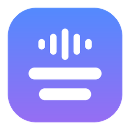

<p align="center">
  
</p>

<h1 align="center">Caption</h1>
<p align="center">Live captions and translation for anything playing on your PC. 100% local, on your GPU.</p>

<p align="center">
  <a href="https://github.com/larosa023/Caption/releases/latest/download/Caption.exe"><b>⬇ Download Caption for Windows</b></a>
</p>

---

## Features

- **Real subtitles in Ripple.** Ripple hands Caption the stream it's playing; Caption makes subtitles from the video's own audio ahead of playback (voice detection, 25-second context windows, word-level timing) and Ripple shows them as an "AI subtitles" track, timed to the word like downloaded subtitles. Apps on the same PC can use the same local API (`127.0.0.1:46277`, see [`SubtitleServer.cs`](src/Caption/Subtitles/SubtitleServer.cs)).
- **Caption anything.** The whole PC, one output device, or only the apps you pick (each app's helper processes included, even if it plays on another device), plus your microphone. Per-app capture uses Windows' process loopback (Windows 10 2004+ / Windows 11).
- **Fast and private.** Speech is recognized by [whisper.cpp](https://github.com/ggml-org/whisper.cpp) on your NVIDIA GPU (CUDA), typically well under a second behind the audio. Nothing is sent to the internet. No GPU? It runs on the CPU.
- **Words appear as they're spoken.** The current line is re-read several times a second and corrected in place; it settles when the speaker pauses. Silero voice activity detection keeps silence and music from turning into text, and Whisper's usual inventions ("Thanks for watching!") are filtered out.
- **Translation.** Detects the spoken language. Show English with Whisper's own translation, or translate into any language through your local [Ollama](https://ollama.com) (pick the model in **Settings → Translation**). Optionally show the original line too.
- **Caption bar.** Floating, click-through and always on top. One line, two lines or a scrolling box. Font, size, bold, text and background color, background opacity, shadow, and style presets (Classic, Cinema, Minimal, High contrast, Match theme). Snap it to the bottom of the screen or of the window you're using, or put it anywhere: **Move & resize** (Home, tray menu or a hotkey) makes it grabbable until you press **Done**.
- **Hotkeys.** **Win + Alt + C** shows or hides captions, **Win + Alt + P** pauses. Moving the bar and opening the transcript can have hotkeys too. **Ctrl + ,** opens Settings.
- **Transcript.** The full running transcript with timestamps, search, copy, and **Save** as .txt or .srt. Optionally saved automatically each time captions stop.
- **Profiles.** Starts with *Everything*, *Streams* (Prism and browsers, translated to English) and *Calls* (Discord + your mic). Add your own and switch from Home or the tray.
- **Themes.** The 14 suite themes (Dark with Mica, Light, Windows, Midnight, Glass, Frost, Twilight, Forest, Sunset, Ocean, Rose, Graphite, Paper, Mist), the suite accent colors, and custom theme files in Hangar's format. Switches live.
- **Light when idle.** With captions off, the speech engine isn't running at all, so GPU memory is completely free (or keep the model loaded for instant starts). No background services, no accounts, no telemetry, no admin rights.
- **Updates itself.** Checks GitHub Releases on launch and every few hours (Stable or Beta), downloads in the background, verifies SHA-256, and shows **Update ready, restart**. If a new version doesn't start, Caption puts the previous one back automatically. Models are never re-downloaded.

## Install

Download **Caption.exe** from the [latest release](https://github.com/larosa023/Caption/releases/latest) and run it. It installs itself per-user to `%LOCALAPPDATA%\Programs\Caption` (no admin needed) and adds a Start menu shortcut. Or install it from **Hangar**.

On first run, pick a model. Caption downloads it once, along with the speech engine for your hardware:

| Model | Size | Best for |
|---|---|---|
| Small | 466 MB | Fastest; the pick without an NVIDIA GPU |
| Medium | 1.5 GB | More accurate; good English translation |
| **Large v3 Turbo** (default on NVIDIA) | 1.6 GB | Near large-model accuracy at live speed |
| Large v3 | 2.9 GB | Most accurate; best English translation |

The GPU engine is the official whisper.cpp CUDA 12.4 build (about 440 MB, includes the CUDA runtime, so no CUDA install is needed). Everything is checked by SHA-256 and kept in `%LOCALAPPDATA%\Caption`.

> Caption isn't code-signed yet, so Windows SmartScreen may show "Windows protected your PC". Click **More info → Run anyway**.

Uninstall from **Settings → Apps → Installed apps**.

### Portable mode

Put an empty file named `portable` next to `Caption.exe`. Caption then runs from that folder and keeps everything (settings, models, transcripts) in `.\data`.

## Releasing a new version

Bump the version in [`src/Caption/Caption.csproj`](src/Caption/Caption.csproj), update `CHANGELOG-latest.md`, and push to `main`:

```xml
<Version>0.2.0</Version>
```

GitHub Actions ([`build.yml`](.github/workflows/build.yml)) builds a self-contained single-file `Caption.exe`, runs an end-to-end self-test (whisper.cpp engine, speech worker, streaming pipeline on a real sample), and publishes a release with `Caption.exe` and `SHA256SUMS.txt`. A version with a `-` (like `0.2.0-beta.1`) is published as a pre-release for the Beta channel. If that version is already released, nothing happens. Models are downloaded at first run, never bundled.

## Building locally

Requires the [.NET 8 SDK](https://dotnet.microsoft.com/download) on Windows.

```bash
dotnet run --project src/Caption
```

## Tech

- .NET 8 + WPF, one self-contained exe
- [whisper.cpp](https://github.com/ggml-org/whisper.cpp) v1.8.2 (CUDA or CPU) running in a separate worker process, with Silero VAD
- [NAudio](https://github.com/naudio/NAudio) for WASAPI loopback and microphone capture; process loopback for per-app audio
- Optional [Ollama](https://ollama.com) for translation into other languages

## License

[MIT](LICENSE)
